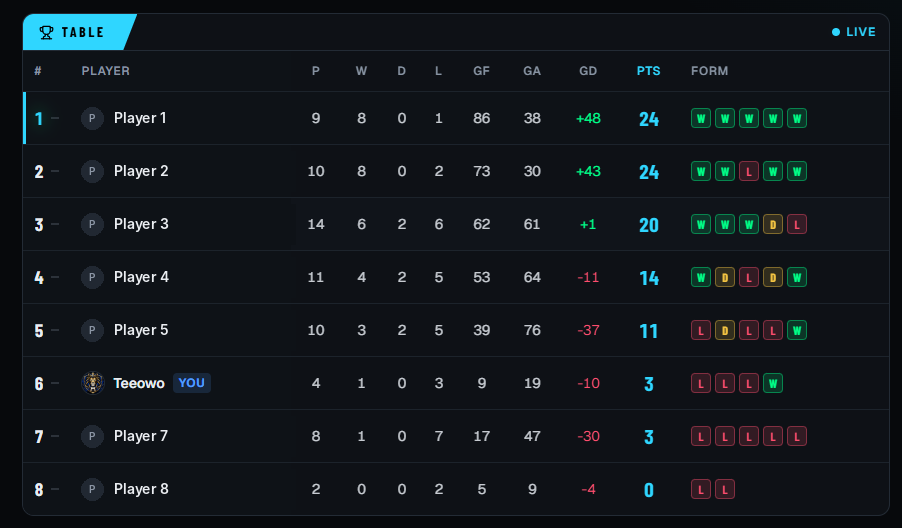

This week [Scoreline](https://scoreline.tosinowobo.com) went live. It's the app I've been building with Claude to run FC 27 leagues and tournaments with friends. On the weekend we ran our first real league on it: **8 players**, real fixtures and a real deadline.

## The setup

Before the weekend I added a new league format. Instead of me entering everyone's results, each player records their own score before the deadline, and the other player confirms it. If there's a disagreement, the organiser has the final say.

It all worked in testing. Then real people started using it.

Here's the table as it stands. Names are hidden apart from mine, and you can see I'm not winning my own league:

<figure class="post-figure">
  
  <figcaption>The live league table on Scoreline. Other players' names are redacted.</figcaption>
</figure>

## What the players showed me

You only learn some things when people are actually trying to get their game recorded before the deadline. Over the weekend players found a few bugs, and, more usefully, the spots where the app slowed them down. Some examples:

- **Recording a game asked for too much.** Now it just asks for the score.
- **Typing in scores was a chore.** Now you can take a photo of the result on your screen and the app reads it.
- **A few features got in the way.** I removed them. If something doesn't help someone record a result, it doesn't need to be on the screen.
- **People weren't sure how long they had.** The league page now says it plainly, like *"Ends tonight, 11:59 PM (21h left)"*, and the colour changes as the deadline gets close.
- **Almost everyone was on their phone.** So I went through every screen on a phone: bigger buttons, long names that don't break the layout, and your next game always easy to find.

## Fixing data in the database

Not every fix was on the screen. A few players had problems with the email addresses on their accounts, and they had to be corrected in the database itself.

This was my favourite part of the week. I described what needed to change, and Opus wrote the SQL scripts to find the affected accounts and update them. The scripts were clean and careful, and easy to read and check before running. It took me back to my time at SAIT, writing database scripts to pull information out and update records. I really enjoyed that work then, and I enjoyed it again here.

## Fast fixes, nothing broken

Most fixes went out the same day the problem showed up. That only works because Scoreline has automatic checks: before anything goes live, the app is built and tested from scratch, including the main things a player does. If something breaks, it doesn't ship.

Over the weekend I pushed thirteen updates, and **none of them broke anything that already worked**.

## What I learned

- **Real users beat any amount of testing.** Eight friends in one weekend found more friction than all my own testing, because they were trying to get something done, not trying the app out.
- **Fast is only good if it's safe.** Claude makes fixes quick to write. The automatic checks are what made me comfortable shipping in the middle of a live league.
- **Old skills still count.** The SQL work reminded me that what I learned at SAIT still matters. It's just faster now, with Claude doing the typing and me checking the logic.

## Next week

- Run a second league and see how it goes when I'm not watching every game.
- Keep improving the score recording, based on what the players tell me.
